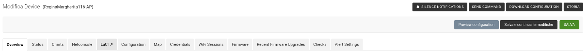

# openwisp-luci

[🇬🇧 English](README.md) · 🇮🇹 Italiano

> 📖 Questo repository fa parte dell'infrastruttura di **NINUX Basilicata**: la guida per ricostruirla tutta, passo passo (Proxmox, DNS, OpenWISP, moduli, firmware, app), è su **[GitHub Pages](https://mikysal78.github.io/ninux-basilicata-infra/)**.

Un pulsante **LuCI ↗** nella barra delle schede della pagina del device in OpenWISP: apre l'interfaccia
web del router in una nuova scheda, attraverso un proxy nginx sul server
OpenWISP. Il router non deve essere raggiungibile dal tuo browser, solo dal
server (LAN, mesh, VPN, ZeroTier...).



```
browser ──https──▶ <uuid del device>.luci.example.com (nginx sul server OpenWISP)
                     │ auth_request ──▶ Django: cookie valido? quale router?
                     └──https──▶ IP di gestione del router (uhttpd, LuCI)
```

- **Un host per router** (`<uuid del device senza trattini>.luci.example.com`):
  ogni router è un'origine separata, quindi i cookie e il JavaScript di un
  router non vedono mai quelli degli altri.
- **Link monouso**: il pulsante dà un token firmato, valido 60 secondi e
  utilizzabile una sola volta, legato all'utente, al device e alla password
  dell'utente.
- **Ogni richiesta è controllata**: l'utente deve essere ancora attivo e avere
  il permesso di modificare il device, la password non deve essere cambiata, il
  device deve esistere ancora e il suo IP di gestione deve stare nelle reti
  ammesse.
- Il login del router resta: il proxy decide solo *chi può raggiungere* LuCI,
  il router resta protetto dalla sua password.

Requisiti: OpenWISP con openwisp-controller ≥ 1.1, nginx con il modulo
`auth_request` (incluso nei pacchetti Debian e Ubuntu), un DNS wildcard e un
certificato per `*.luci.example.com`.

## Installazione

1. **DNS**: un record wildcard che punta al server OpenWISP, per esempio
   `*.luci.example.com. CNAME openwisp.example.com.`
2. **Certificato** per `*.luci.example.com` (un certificato `*.example.com` non
   lo copre). Con acme.sh e DNS-01:
   `acme.sh --issue --dns dns_nsupdate -d luci.example.com -d '*.luci.example.com'`
3. **OpenWISP**, con il ruolo [ansible-openwisp2](https://github.com/openwisp/ansible-openwisp2)
   (esempio completo in [`examples/ansible`](examples/ansible)):

   ```yaml
   openwisp2_extra_python_packages:
     - "openwisp-luci @ https://github.com/mikysal78/openwisp-luci/releases/download/v0.3.1/openwisp_luci-0.3.1-py3-none-any.whl"
   # dopo le app che registrano o estendono l'admin del device
   # (openwisp-monitoring, openwisp-netconsole...)
   openwisp2_extra_django_apps:
     - openwisp_luci
   openwisp2_extra_urls:
     - 'path("__openwisp_luci__/", include("openwisp_luci.urls"))'
     - 'path("api/v1/", include("openwisp_luci.api_urls"))'
   openwisp2_extra_django_settings_instructions:
     - |
       OPENWISP_LUCI_HOST = "{id}.luci.example.com"
       OPENWISP_LUCI_OPENWISP_URL = "https://openwisp.example.com"
       ALLOWED_HOSTS.append(".luci.example.com")
   ```

   e il ruolo `luci_proxy` dell'esempio per il virtual host di nginx.
4. **Router**: uhttpd deve rispondere sull'IP di gestione dal server, in HTTPS
   (il default di OpenWrt con `luci-ssl` o `uhttpd` + `px5g`). Se l'interfaccia
   di gestione sta in una zona firewall con `input REJECT` (per esempio `wan`),
   apri TCP 443 solo dal server:

   ```json
   {"config_name": "rule", "config_value": "allow_luci_openwisp", "name": "Allow-LuCI-OpenWISP",
    "src": "wan", "src_ip": "192.0.2.10", "proto": "tcp", "dest_port": "443", "target": "ACCEPT"}
   ```

## Impostazioni

| Impostazione | Default | Significato |
|---|---|---|
| `OPENWISP_LUCI_HOST` | `None` | Host del proxy, `{id}` diventa l'UUID del device senza trattini. `None` nasconde il pulsante. |
| `OPENWISP_LUCI_ALLOWED_NETWORKS` | IPv4 privati + `fc00::/7` | Reti in cui può stare l'IP di gestione. Restringila alla tua rete (es. `["10.27.0.0/16"]`). |
| `OPENWISP_LUCI_TOKEN_AGE` | `60` | Secondi di validità del link monouso. |
| `OPENWISP_LUCI_SESSION_AGE` | `14400` | Secondi di validità del cookie del proxy; poi si riusa il pulsante. |
| `OPENWISP_LUCI_SUPERUSER_ONLY` | `False` | Solo i superuser vedono e usano il pulsante. |
| `OPENWISP_LUCI_OPENWISP_URL` | `None` | Indirizzo di OpenWISP, per il link nella pagina «accesso negato». |
| `OPENWISP_LUCI_AUTO_LOGIN` | `False` | Accesso automatico a LuCI per i superuser, vedi sotto. |
| `OPENWISP_LUCI_AUTO_LOGIN_USER` | `"admin"` | Utente del router della sessione automatica (una sezione `login` di `/etc/config/rpcd`). |
| `OPENWISP_LUCI_AUTO_LOGIN_TIMEOUT` | `10` | Secondi concessi alla connessione SSH e alla sessione. |

Ogni apertura finisce nel log (logger `openwisp_luci`, livello INFO) con
utente, device e IP del router.

## Accesso automatico

Con `OPENWISP_LUCI_AUTO_LOGIN = True`, un **superuser** che preme il pulsante
entra direttamente in LuCI, già autenticato. OpenWISP apre la connessione SSH
che usa già per i comandi (le **Credentials** del device) ed esegue sul router
un piccolo script [ucode](openwisp_luci/router_session.uc): crea una sessione
rpcd per `OPENWISP_LUCI_AUTO_LOGIN_USER` con le stesse ACL che rpcd darebbe a
quell'utente al login (`/etc/config/rpcd` e `/usr/share/rpcd/acl.d`), con la
durata delle sessioni di LuCI (`luci.sauth.sessiontime`), e ne stampa l'ID. Il
proxy lo imposta come cookie di LuCI `sysauth_https` (`Secure`, `HttpOnly`,
`SameSite=Strict`, path `/cgi-bin/luci/`) solo sull'host di quel router.

- Nessuna password del router sul server: chi controlla OpenWISP può già
  eseguire comandi sui router con la stessa connessione SSH.
- L'ID della sessione è una credenziale: il comando passa direttamente dal
  canale paramiko, non da `exec_command` di openwisp-controller, che scrive
  l'output nel log.
- Solo i superuser: gli altri utenti vedono la pagina di login di LuCI. Usa un
  utente dedicato del router (es. `admin`), così root continua a entrare con
  la sua password.
- Ogni clic crea una sessione nuova; il logout di LuCI la distrugge, altrimenti
  scade dopo la durata di inattività delle sessioni di LuCI.
- Se il router non è raggiungibile in SSH, LuCI si apre con la pagina di login.

## API per le app

Le app come [openwisp-android](https://github.com/mikysal78/openwisp-android)
aprono LuCI con il token delle API di OpenWISP dell'utente:

```
POST /api/v1/luci/device/<uuid del device>/link/
Authorization: Bearer <token da /api/v1/users/token/>

200 {"url": "https://<host del device>/__openwisp_luci__/login/?token=..."}
```

L'app apre l'URL nel browser, che da lì funziona come con il pulsante. I
controlli sono gli stessi del pulsante; l'API accetta solo il token Bearer, mai
la sessione del browser. Risposte: `401` token mancante o non valido, `404`
device inesistente o non consentito (i due casi non si distinguono), `409` IP
di gestione mancante o non ammesso. Senza l'include di `api_urls` l'API non
esiste.

## Sicurezza

- **Chi**: utenti staff con il permesso `change_device` che gestiscono
  l'organizzazione del device, oppure i superuser. Il pulsante e le viste lo
  ricontrollano a ogni richiesta.
- **Dove**: l'IP di gestione lo dichiara il router stesso, quindi un router
  compromesso potrebbe farlo puntare ovunque. Il proxy rifiuta indirizzi di
  loopback, link-local, multicast e riservati, e ogni indirizzo fuori da
  `OPENWISP_LUCI_ALLOWED_NETWORKS`. Schema e porta sono fissi in nginx.
- **Cookie**: `__Host-openwisp-luci`, firmato, `Secure`, `HttpOnly`,
  `SameSite=Strict`, valido solo sull'host del suo device. nginx lo toglie
  prima di inoltrare la richiesta, quindi il router non lo riceve mai.
- **Token nell'URL**: monouso, 60 secondi, non scritto nell'access log di
  nginx, `Referrer-Policy: no-referrer`.
- **Traffico verso il router**: resta cifrato fino al router (HTTPS). Il
  certificato del router è autofirmato e non viene verificato.
- **Stesso sito**: le pagine dei router sono servite su un sottodominio dello
  stesso dominio di OpenWISP. Django rifiuta i POST da altre origini
  controllando l'header `Origin`, ma un sottodominio può impostare cookie per
  il dominio padre. Dai al cookie di sessione di OpenWISP il prefisso
  `__Host-`, che i sottodomini non possono impostare né sovrascrivere:

  ```python
  SESSION_COOKIE_NAME = "__Host-sessionid"  # una volta fa uscire tutti
  ```

  Se puoi, usa per il proxy un dominio separato (es. `{id}.luci.example.net`).

Segnala le vulnerabilità in privato: vedi [SECURITY.md](SECURITY.md).

## Sviluppo

```sh
pip install pytest "django~=5.2.0" ruff
pytest
ruff check . && ruff format --check .
```

La CI valida anche il virtual host nginx dell'esempio e controlla che il
router non riceva mai il cookie del proxy.

## Licenza

GPL-3.0-or-later.
